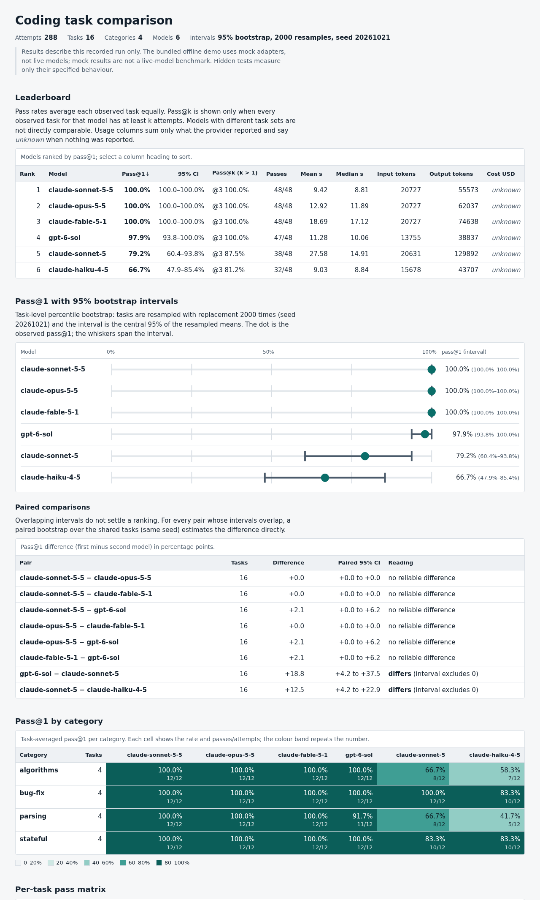
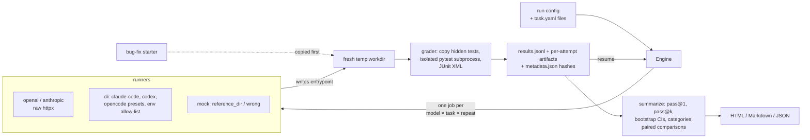

<p align="center"></p>

<p align="center"><b>Compare coding models and agent CLIs on the same tasks, graded by tests they never see.</b></p>

<p align="center">
  <a href="https://github.com/muhib-karim/agent-eval-harness/actions/workflows/ci.yml"></a>
  <a href="https://github.com/muhib-karim/agent-eval-harness/actions/workflows/codeql.yml"></a>
  
  <a href="https://github.com/muhib-karim/agent-eval-harness/releases"></a>
  <a href="LICENSE"></a>
  
  <a href="https://muhib-karim.github.io/agent-eval-harness/"></a>
</p>

# agent-eval-harness

A CLI and Python library for comparing coding models and coding-agent commands on the same
tasks. Each attempt writes a Python module. The harness then grades it against pytest files the
model never saw, keeps the evidence (raw output, generated source, test log, a JSONL record), and
reports pass@k with bootstrap confidence intervals.

**Latest measured run (21 October 2026):** six models × 16 tasks × three repeats, 288 graded
attempts through the harness's HTTP runners. pass@1 ranges from 66.7% to 100%; three models
solve every attempt ([results](#measured-results), [methodology](results/2026-10-21-measured/METHODOLOGY.md),
[live report](https://muhib-karim.github.io/agent-eval-harness/),
[raw attempts](results/2026-10-21-measured/)). The 17 October run is kept as
[history](#earlier-run-17-october-2026).

## Contents

[Showcase](#showcase) · [Why it exists](#why-it-exists) · [Quickstart](#quickstart) ·
[Usage](#usage) · [Isolation](#isolation) · [Task catalogue](#task-catalogue) ·
[Architecture](#architecture) · [Measured results](#measured-results) ·
[Design decisions](#design-decisions) · [Limitations](#limitations) · [Roadmap](#roadmap) ·
[Development](#development) · [Citation](#citation)

## Showcase

The HTML report for the 21 October 2026 run, rendered headless at 1280 px. It is one
self-contained file: a sortable leaderboard (keyboard-operable, a plain table without
JavaScript), per-model 95% bootstrap intervals, paired comparisons where intervals overlap, a
per-category heatmap with the number in every cell, and `unknown` wherever the provider did not
report usage. It has a dark mode and a 375 px layout. The live version is the
[project site](https://muhib-karim.github.io/agent-eval-harness/).



## Why it exists

Comparing models by reading a few of their answers gives results you can't reproduce, and
people tend to believe the answer that looks most convincing. Evaluation scripts written in a
hurry add other problems: tests left in the agent's workspace, a single sample reported as
"pass@k", a ranking with no error bars, and missing token counts shown as zero. This project
handles those cases explicitly:

- **Withheld tests.** Pytest files are copied into the workdir only after the model or agent has
  finished, then removed.
- **Isolated grading.** Each attempt is graded in its own `python -I` pytest subprocess with
  conftest, plugins and config disabled; outcomes come from JUnit XML.
- **Statistics that admit uncertainty.** Unbiased pass@k over repeated attempts, macro-averaged
  over tasks; seeded task-level bootstrap 95% intervals; a paired bootstrap whenever two models'
  intervals overlap; per-category breakdowns.
- **Honest usage.** Token counts and cost stay `unknown` (null) unless the endpoint reports them.
- **Evidence for every attempt.** Raw output, generated source and test log, append-only
  `results.jsonl`, SHA-256 provenance in `metadata.json`, and `--resume` for interrupted runs.
- **Models and agents alike.** Raw-`httpx` adapters for Chat Completions and Messages APIs (no
  vendor SDKs), plus `cli` presets for Claude Code, Codex and opencode with an environment
  allow-list and optional private `HOME`.
- **Tasks that test something.** 16 bundled tasks in four categories, including bug-fix tasks.
  CI proves every task is solvable and that no hidden test passes on an empty or stub module.

## Quickstart

```sh
git clone https://github.com/muhib-karim/agent-eval-harness && cd agent-eval-harness
pipx install '.[grade]'          # or: python -m venv .venv && . .venv/bin/activate && pip install '.[grade]'
agent-eval run examples/mock-demo.yaml --out runs/demo
```

The demo needs no network access or credentials. It runs the 16 tasks × two mock "models" × two
repeats (64 attempts, about a minute). `mock-reference` submits each task's reference solution
and `mock-wrong` submits a module that returns `None` for everything, so the run exercises the
harness, not a model. Open `runs/demo/report.html` in a browser; a Markdown rendering of the same
kind of run is in [docs/sample-report.md](docs/sample-report.md).

The `grade` extra installs pytest, which the grader needs. To install a tagged release build
instead of a checkout (each release carries a wheel, an sdist and `SHA256SUMS.txt`, built by the
[release workflow](.github/workflows/release.yml)):

```sh
pip install "agent-eval-harness[grade] @ https://github.com/muhib-karim/agent-eval-harness/releases/download/v1.3.0/agent_eval_harness-1.3.0-py3-none-any.whl"
```

## Usage

```sh
agent-eval run CONFIG [--out DIR] [--resume] [--isolation local|docker]  # writes results.jsonl + report.html
agent-eval report RESULTS.jsonl --format html|md|json [--k N ...] [--seed S] [--resamples R]
agent-eval list-tasks                              # id, title and path of each bundled task
agent-eval validate-task tasks/semver/task.yaml --reference tests/fixtures/reference/semver.py
```

**Real endpoints.** Put model ids in a config such as
[`examples/real-models.yaml`](examples/real-models.yaml). The config names environment variables;
URLs and keys stay in the environment. Live runs may cost money.

```sh
export COMPATIBLE_BASE_URL=... MESSAGES_BASE_URL=...   # include the API version path, e.g. .../v1
read -rs COMPATIBLE_API_KEY && read -rs MESSAGES_API_KEY && export COMPATIBLE_API_KEY MESSAGES_API_KEY
agent-eval run examples/real-models.yaml --out runs/real-comparison
```

**Agent CLIs.** The `cli` runner has presets for `claude-code`, `codex` and `opencode`
([`examples/agent-clis.yaml`](examples/agent-clis.yaml)). Each agent runs headless in a fresh
workdir, receives only an allow-list of environment variables (base variables, the preset's
credential names and anything in `env_passthrough`), and can get an empty private `HOME` with
`isolate_home: true`. Any other agent works through an explicit `command`.

**Interrupted runs.** `agent-eval run CONFIG --out DIR --resume` continues a killed run: it
checks that the config and task files are unchanged, keeps every recorded attempt (errors
included), and runs only the missing ones.

Config fields, runner options, the task format, the JSONL schema and exit codes are documented
in [docs/reference.md](docs/reference.md).

## Isolation

`--isolation docker` (or `isolation: {mode: docker}` in the run config; the flag wins) runs each
attempt's untrusted code in its own throwaway container: the `cli` runner's agent command and the
hidden-test grading. HTTP and mock runners start no process during generation, so only their
grading is containerised. Every container gets:

| Setting | Default | Config key |
| --- | --- | --- |
| Network | `--network none` | `network` (`none`, or `bridge` to opt in) |
| Memory | `2g`, swap disabled (`--memory-swap` equals `--memory`) | `memory` |
| CPUs | `2` | `cpus` |
| Processes | `--pids-limit 256` | `pids_limit` |
| Image | `python:3.12-slim` | `image` |
| Docker client | `docker` on `PATH` | `docker` |

Fixed hardening: read-only root filesystem, the attempt workdir bind-mounted read-write at
`/work`, a 256 MB `/tmp` tmpfs (also `HOME` and `TMPDIR`), `--cap-drop ALL`,
`no-new-privileges`, your own uid:gid on POSIX, a unique container name and two labels:
`agent-eval.attempt=<name>` and `agent-eval.run=<run id>` (a fresh id per run). Host paths in
the command (`{workdir}`, `{prompt_file}`, the test paths) are rewritten to `/work`, with `/`
separators even on a Windows host. Environment variables are passed as `--env NAME`, so values
never appear in a process list.

**Container lifecycle.** Each command runs in two steps under the attempt's timeout: `docker
create` (all the settings above; a pull of a missing image counts against the timeout) must
finish before `docker start --attach` runs the command. Once `start` has run, the container is
known to exist, so whatever happens next (clean exit, failure, timeout, cancellation) it is
removed with `docker rm --force` before the attempt's workdir is released; this cleanup is not
cancellable. A failed removal is retried a few times within a short budget; if it still fails,
the attempt keeps its outcome, its output ends with
`[agent-eval: container <name> could not be removed]` and a warning goes to stderr.

A `create` interrupted mid-flight (timeout or Ctrl-C) may still produce a container once the
daemon finishes it. At the end of every run with docker isolation, also after an error or
Ctrl-C, the harness sweeps: it lists `docker ps -aq --filter label=agent-eval.run=<run id>` and
force-removes what it finds, with a warning on stderr giving the count found and any that could
not be removed. Residual risk: if the daemon is extremely slow and completes a `create` after
the sweep, that container is left over; it stays findable by its labels:

```sh
docker ps -a --filter label=agent-eval.run          # all runs; or label=agent-eval.run=<run id>
docker rm --force $(docker ps -aq --filter label=agent-eval.run)
```

```yaml
isolation:
  mode: docker
  image: agent-eval-harness   # docker build -t agent-eval-harness .
  network: none               # use bridge for agents that call an API
  memory: 1g
  cpus: 1.5
```

- **The image must have pytest** for grading, which runs the image's `python`. `python:3.12-slim`
  alone does not; the harness's own `Dockerfile` image does (its entrypoint is bypassed). For
  `cli` runs the agent CLI must also be installed in the image; host paths to it do not exist
  there.
- Pull or build the image before the run; a pull during an attempt counts against its timeout.
- **Fallback.** Before the run the harness asks the daemon for its version (10 s timeout). If
  `docker` is missing or the daemon is unreachable, the run uses the local runner, prints one
  warning to stderr and records it on every attempt.
- Custom runners that start their own processes are not containerised.
- **Resume** requires the same isolation mode as the interrupted run, after `--isolation`: a run
  started with `--isolation docker` must be resumed with it. Runs recorded before isolation
  existed count as `local`.

**Schema change.** `results.jsonl` lines gain an optional `isolation` object, e.g.
`{"requested": "docker", "used": "local", "warning": "docker isolation unavailable (...)"}`, or
`{"requested": "local", "used": "local", "warning": null}` for a normal run. It is additive:
older files without it still load, resume and report, and `schema_version` stays `"1.0"`.

## Task catalogue

16 tasks, four per category, 279 hidden tests in total. Reference solutions are kept out
of the task directories, in `tests/fixtures/reference/`. Bug-fix tasks give the model a buggy
module plus an issue report and ask for the fixed module; their hidden tests catch the bug and
guard against regressions.

| Task | Category | What it asks for | Hidden tests |
| --- | --- | --- | ---: |
| `intervals` | algorithms | Merge closed integer intervals | 13 |
| `levenshtein` | algorithms | Edit distance in O(min(m, n)) memory with an early-exit bound | 17 |
| `roman` | algorithms | Canonical Roman numeral encode/decode round-trip | 33 |
| `topo_sort` | algorithms | Lexicographically smallest topological order, cycle detection, 10k-node chains | 12 |
| `arithmetic` | parsing | Tokenize and evaluate `+ - * / ( )` expressions without `eval` | 31 |
| `ini_parser` | parsing | Strict INI dialect with line-numbered errors | 16 |
| `json_path` | parsing | `a.b[0].c`-style lookup into parsed JSON, with a default | 26 |
| `semver` | parsing | Semantic Versioning 2.0.0 parsing and precedence | 27 |
| `ledger` | stateful | Thread-safe accounts with atomic, deadlock-free transfers | 16 |
| `lru_ttl` | stateful | LRU cache with fixed TTL and an injectable clock | 11 |
| `rate_limiter` | stateful | Per-key sliding-window rate limiter | 11 |
| `undo_buffer` | stateful | Text buffer with undo, redo and grouped (transactional) edits | 18 |
| `fix_binary_search` | bug-fix | `find_last` misses present targets; stay O(log n) | 12 |
| `fix_memoize` | bug-fix | `@memoize` ignores keyword arguments | 10 |
| `fix_running_stats` | bug-fix | Variance wrong after merging two streams | 13 |
| `fix_slugify` | bug-fix | `slugify` emits runs of separators | 13 |

## Architecture



| Module | Responsibility |
| --- | --- |
| `specs.py` | Pydantic models for `task.yaml` (incl. `category`, `starter`) and run configs; glob discovery; path containment |
| `engine.py` | Builds jobs, runs them under a semaphore in an `asyncio.TaskGroup`, places starters, writes artifacts and hashes, redacts keys, resumes |
| `runners/` | `Runner` protocol and registry; HTTP adapters on raw `httpx`; CLI runner and agent presets; offline mock |
| `grader.py` | Copies tests in after generation, runs pytest in an isolated interpreter, maps JUnit XML to an outcome |
| `isolation.py` | `isolation:` options, the per-attempt `docker create`/`start` lifecycle, the end-of-run sweep, the docker probe and local fallback |
| `process.py` | Subprocess runner with timeout, output cap and process-group kill |
| `results.py` | JSONL schema, loading, pass@k, per-model and per-category summaries, paired comparisons |
| `stats.py` | Seeded task-level percentile bootstrap and paired bootstrap of differences |
| `report.py` | Markdown, JSON, and the self-contained HTML report (Jinja2 template, inline SVG, no external assets) |

Runtime dependencies: pydantic, PyYAML, httpx, jinja2. pytest is the optional `grade` extra.

## Measured results

### 21 October 2026: six models, 16 tasks, three repeats

288 attempts, each a real API call through the harness's `anthropic` or `openai` runner, graded
against withheld tests in an isolated subprocess. Config:
[`examples/measured-2026-10-21.yaml`](examples/measured-2026-10-21.yaml). Every reply, extracted
module and pytest log is committed under [`results/2026-10-21-measured/`](results/2026-10-21-measured/),
and [METHODOLOGY.md](results/2026-10-21-measured/METHODOLOGY.md) records the settings, model
selection and every failure as it happened.

| Model (id, 21 Oct 2026) | pass@1 | 95% CI | pass@3 | Tasks solved 3/3 | Median wall time (s) | Output tokens (48 attempts) |
| --- | ---: | ---: | ---: | ---: | ---: | ---: |
| claude-sonnet-5-5 | 100.0% | 100.0–100.0% | 100.0% | 16 / 16 | 8.8 | 55,573 |
| claude-opus-5-5 | 100.0% | 100.0–100.0% | 100.0% | 16 / 16 | 11.9 | 62,037 |
| claude-fable-5-1 | 100.0% | 100.0–100.0% | 100.0% | 16 / 16 | 17.1 | 74,638 |
| gpt-6-sol | 97.9% | 93.8–100.0% | 100.0% | 15 / 16 | 10.1 | 38,837 |
| claude-sonnet-5 | 79.2% | 60.4–93.8% | 87.5% | 11 / 16 | 14.9 | 129,892 |
| claude-haiku-4-5 | 66.7% | 47.9–85.4% | 81.2% | 8 / 16 | 8.8 | 43,707 |

pass@k is the unbiased estimator over n = 3 attempts per task, macro-averaged over the 16 tasks.
The interval is a task-level percentile bootstrap (seed 20261021, 2000 resamples). Wall time
covers generation plus grading. Cost is unknown because no endpoint reported it.

| Category (4 tasks each) | sonnet-5-5 | opus-5-5 | fable-5-1 | gpt-6-sol | sonnet-5 | haiku-4-5 |
| --- | ---: | ---: | ---: | ---: | ---: | ---: |
| algorithms | 100.0% | 100.0% | 100.0% | 100.0% | 66.7% | 58.3% |
| bug-fix | 100.0% | 100.0% | 100.0% | 100.0% | 100.0% | 83.3% |
| parsing | 100.0% | 100.0% | 100.0% | 91.7% | 66.7% | 41.7% |
| stateful | 100.0% | 100.0% | 100.0% | 100.0% | 83.3% | 83.3% |

What the run shows:

- **The top four cannot be separated on this suite.** Their intervals overlap, and every paired
  interval among them includes zero. gpt-6-sol's single miss (one `json_path` attempt accepting
  `$.[0]`) is within noise. A harder suite is needed to rank them.
- **The lower two differ reliably, even though their intervals overlap.** Paired over the same
  tasks, gpt-6-sol leads claude-sonnet-5 by +18.8 points (95% CI +4.2 to +37.5) and
  claude-sonnet-5 leads claude-haiku-4-5 by +12.5 points (+4.2 to +22.9). The marginal intervals
  alone would not show this.
- **claude-sonnet-5 ran out of output budget.** Six of its attempts used the full 8,192-token
  `max_tokens`: four returned no text at all and two were graded on truncated code. It produced
  129,892 output tokens, about 1.7 times the next-highest model (claude-fable-5-1, 74,638). The budget was the same for every
  Messages-API model and as in the 17 October run, and it was not raised after the fact.
- **The full-width digit still separates models on `arithmetic`.** claude-sonnet-5 and
  claude-haiku-4-5 failed all six attempts on the same single test (30/31): `"\uff12"` must be
  rejected, but `str.isdigit()` and `float()` accept it. The 17 October run found the same failure.
- **Four claude-haiku-4-5 errors are reply-format errors.** The prompt asks for one code block.
  Those replies added a second block (a quoted line or a filename) or doubled a fence, so the
  joined module failed at import. They count as errors, as the extraction rule is documented; a
  stricter rule is on the roadmap rather than applied after the fact.
- **Bug-fix was the easiest category here** (97.2% averaged over the six models). The only
  stateful misses were on `undo_buffer` (claude-sonnet-5 and claude-haiku-4-5, 1/3 each); the
  threaded `ledger` was solved on every attempt by every model.

Reproduce once `ANTHROPIC_BASE_URL`/`ANTHROPIC_API_KEY` and `OPENAI_BASE_URL`/`OPENAI_API_KEY` are
set (base URLs with the API version path):

```sh
pip install '.[grade]' && agent-eval run examples/measured-2026-10-21.yaml --out runs/measured
```

Limits: sixteen small single-module Python tasks, three repeats, one day, default temperatures
and a fixed output budget. Read it as a regression baseline for these tasks and settings, not as
a general ranking of the models.

### Earlier run (17 October 2026)

The first measured run used six models on the original six tasks, three repeats each (108
attempts) with harness 1.2.0. Its evidence and regenerated report are in
[`results/2026-10-17-measured/`](results/2026-10-17-measured/) and on the
[history page](https://muhib-karim.github.io/agent-eval-harness/history/2026-10-17/).

| Model (id, 17 Oct 2026) | pass@1 | 95% CI | pass@3 |
| --- | ---: | ---: | ---: |
| gpt-6-sol | 100.0% | 100.0–100.0% | 100.0% |
| claude-opus-5-5 | 100.0% | 100.0–100.0% | 100.0% |
| claude-sonnet-5 | 72.2% | 38.9–100.0% | 83.3% |
| deepseek-chat | 61.1% | 27.8–94.4% | 66.7% |
| grok-4.3 | 50.0% | 16.7–83.3% | 50.0% |
| claude-haiku-4-5 | 44.4% | 11.1–77.8% | 66.7% |

The two runs are not directly comparable: the task sets differ (6 vs 16 tasks), and deepseek-chat
and grok-4.3 were not available for the second run. The intervals here were computed later from
the unchanged 17 October results with the 1.3.0 bootstrap.

## Design decisions

- **Tests are withheld until generation finishes.** They are copied into a temporary subdirectory
  of the workdir only after the runner returns, so an agent can't read or edit them in its
  workspace. It is not access control: a CLI agent can still read the host unless you isolate it.
- **Pass@k uses the unbiased estimator over n attempts per task**, reported only for k ≤ n on
  every task, and scores are macro-averaged so a task with more attempts doesn't count for more.
- **Intervals resample tasks, not attempts.** Repeats of one task are correlated, so the bootstrap
  draws whole tasks with replacement (seed 20261021, 2000 resamples). Two models are compared with
  a paired bootstrap over shared tasks, which removes the between-task variance that two
  marginal intervals double count.
- **Each grading run is its own subprocess** (`python -I`, `--noconftest`, plugin autoload off,
  config file `/dev/null`). A generated `conftest.py` or `pytest.ini` has no effect, and the
  process group is killed on exit, timeout or cancellation.
- **No vendor SDKs.** Both HTTP protocols share one `httpx` class; the request payload is visible
  in the code and protocol tests use `httpx.MockTransport` with no network.
- **Unknown usage stays unknown.** Missing token counts are `null`, not 0; cost comes only from a
  reported figure, never from a pricing table; reports show how many attempts reported each one.
- **Agents get least privilege by default.** CLI agents see an environment allow-list, and
  forwarded credential values are redacted from saved artifacts.
- **Every run gets its own directory with provenance**: SHA-256 hashes of the config, task specs,
  tests, starters and references; JSONL flushed after each attempt; resume refuses to continue
  if any of them changed.

## Limitations

- **No sandbox by default.** Without `--isolation docker` (or when it falls back), generated code
  runs as your user with full filesystem and network access. Run untrusted generations only in
  a container: per attempt with [`--isolation docker`](#isolation), or the whole harness as in
  [SECURITY.md](SECURITY.md). A container shares the host kernel; it is not a VM.
- Python only; each task is a single standalone module and no dependencies are installed.
- The tasks are small and public. Models may have memorized similar problems, and the tests
  check only the stated contract, not code quality.
- No retries or rate-limit backoff: a provider error is recorded as an `error` attempt.
- The agent-CLI presets follow each tool's documented headless mode and are tested with a fake CLI
  in CI, not against the real tools; flags can change between CLI releases.
- Only the entrypoint is archived from a CLI agent's workdir, and captured output is capped at
  1 MB per process. Process-group cleanup is POSIX-only.

## Roadmap

- Measured runs of the agent-CLI presets against the real tools.
- Tasks in languages other than Python, and repository-level tasks graded from a patch.
- Optional cost estimates from a versioned pricing file, labelled separately from reported cost.
- Retry with backoff for transient provider errors, recorded as such rather than hidden.

## Development

```sh
python -m pip install -e '.[dev]'
ruff check . && ruff format --check .   # lint + formatting
mypy --strict                           # type-check src/ and tests/
pytest                                  # 229 tests, branch coverage gate 85%
python -m build                         # sdist + wheel
agent-eval run examples/mock-demo.yaml  # end-to-end offline demo
```

The Makefile wraps the same steps: `make install`, `make lint typecheck test`, `make demo`.

[CI](.github/workflows/ci.yml) runs lint, format, strict mypy and the tests with the coverage
gate on Python 3.11 and 3.12, builds the sdist and wheel, runs the offline demo from a
non-editable install, builds the Docker image and runs the demo inside it with
`--network none`, and scans the history with gitleaks. [CodeQL](.github/workflows/codeql.yml)
runs on pushes, pull requests and weekly; recorded model outputs under `results/` are evaluation
data and are excluded from scanning ([why](CONTRIBUTING.md#code-scanning)). Dependabot keeps pip
and Actions dependencies current.
[`pages.yml`](.github/workflows/pages.yml) publishes the project site from `main`.

See [CONTRIBUTING.md](CONTRIBUTING.md), [SECURITY.md](SECURITY.md) and
[CHANGELOG.md](CHANGELOG.md).

```text
src/agent_eval/        package: cli, engine, grader, process, results, stats, report, specs
  runners/             Runner protocol + registry, HTTP adapters, CLI runner + presets, mock
  templates/           self-contained HTML report template
tasks/<id>/            task.yaml, hidden_tests.py (+ starter.py for bug-fix tasks)
tests/                 pytest suite (no network); fixtures/reference/ holds task solutions
examples/              mock demo, real-model, agent-CLI and measured-run configs
results/               committed evidence for each measured run
docs/                  reference.md, sample report, banner and screenshots
.github/               CI, CodeQL, Pages and release workflows; Dependabot
```

## Tech stack

- **Language:** Python
- **Frameworks and tools:** Pydantic, httpx, pytest, Ruff, mypy, Docker
- **CI:** GitHub Actions

## Contributing

Issues and pull requests are welcome. See [CONTRIBUTING.md](CONTRIBUTING.md) for the workflow. Before opening a pull request, run `pytest`. Please keep each pull request focused and say how you tested it.

## Citation

If you use this harness or its results, please cite it using [`CITATION.cff`](CITATION.cff)
(GitHub's "Cite this repository" button renders it as APA or BibTeX).

## Links

- Project site (latest measured report): https://muhib-karim.github.io/agent-eval-harness/
- Earlier run (17 October 2026): https://muhib-karim.github.io/agent-eval-harness/history/2026-10-17/
- Offline demo report: https://muhib-karim.github.io/agent-eval-harness/demo/
- Reference documentation: [docs/reference.md](docs/reference.md)
- Changelog: [CHANGELOG.md](CHANGELOG.md)

## License

MIT. See [LICENSE](LICENSE).
